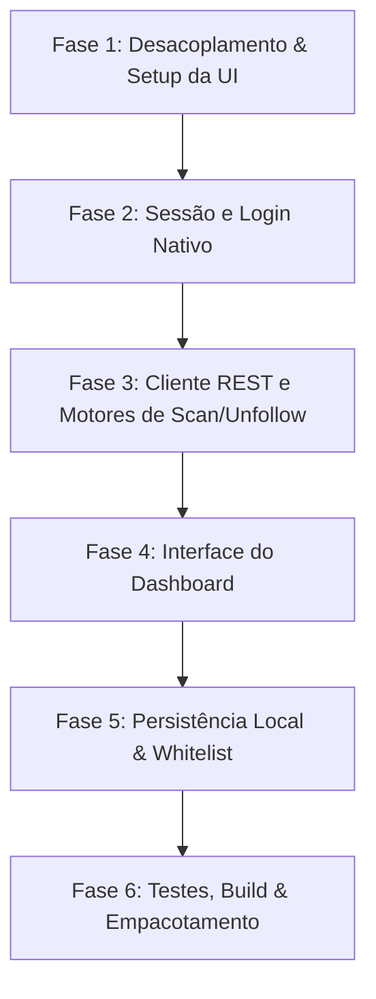

# 03. Plano de Implementação Passo a Passo

Este documento apresenta o roteiro prático e detalhado para implementar a solução e colocar o **GhostGram Desktop** em estado 100% funcional.

---

## 📅 Visão Geral das Fases



---

## 🚀 Fase 1: Desacoplamento e Setup da UI do Desktop

### Objetivo
Tornar o pacote `packages/desktop` auto-suficiente, com sua própria compilação de interface e processo principal organizado.

### Passos de Execução:
1. **Reorganizar a estrutura de pastas**:
   ```
   packages/desktop/
   ├── src/
   │   ├── main/
   │   │   ├── index.ts                (Entry point do Electron)
   │   │   ├── InstagramSessionManager.ts
   │   │   ├── DesktopInstagramApiClient.ts
   │   │   ├── DesktopScanEngine.ts
   │   │   ├── DesktopUnfollowEngine.ts
   │   │   └── DesktopStorageManager.ts
   │   ├── preload/
   │   │   └── index.ts                (Bridge tipado)
   │   └── renderer/                   (Interface React Desktop)
   │       ├── index.html
   │       ├── src/
   │       │   ├── App.tsx
   │       │   ├── components/
   │       │   │   ├── Header.tsx
   │       │   │   ├── UserTable.tsx
   │       │   │   ├── ScanProgressBar.tsx
   │       │   │   ├── WhitelistManagerModal.tsx
   │       │   │   └── SettingsModal.tsx
   │       │   └── styles/
   │       │       └── index.css
   ├── vite.config.ts                  (Build do renderer)
   ├── tsconfig.json
   └── package.json
   ```
2. **Atualizar `package.json`**:
   - Adicionar dependência para `@ghostgram/shared: workspace:*`.
   - Adicionar `react`, `react-dom`, `@types/react`, `@types/react-dom`, `@vitejs/plugin-react` e `vite`.
   - Adicionar scripts:
     - `"dev:renderer"`: `"vite"`
     - `"build:renderer"`: `"vite build"`
     - `"dev:electron"`: `"tsc -p tsconfig.main.json && electron ."`
     - `"dev"`: `"concurrently -k \"pnpm dev:renderer\" \"wait-on http://localhost:5173 && pnpm dev:electron\""`
     - `"build"`: `"pnpm build:renderer && tsc -p tsconfig.main.json && electron-builder"`

---

## 🔐 Fase 2: Sessão e Login Nativo no Instagram

### Objetivo
Permitir que o usuário faça login na sua conta do Instagram sem sair do aplicativo e capturar as credenciais da sessão.

### Implementação de `InstagramSessionManager.ts`:
```typescript
import { BrowserWindow, session } from 'electron';

export class InstagramSessionManager {
  private readonly partition = 'persist:instagram';

  async openLoginWindow(parentWindow: BrowserWindow): Promise<boolean> {
    const loginWindow = new BrowserWindow({
      width: 500,
      height: 700,
      parent: parentWindow,
      modal: true,
      webPreferences: {
        partition: this.partition,
        nodeIntegration: false,
        contextIsolation: true,
      },
    });

    await loginWindow.loadURL('https://www.instagram.com/accounts/login/');

    return new Promise((resolve) => {
      loginWindow.webContents.on('did-navigate', async (_, url) => {
        // Se navegou para a página principal após login
        if (url === 'https://www.instagram.com/' || url.startsWith('https://www.instagram.com/?')) {
          const cookies = await this.getCookies();
          if (cookies.ds_user_id && cookies.sessionid) {
            loginWindow.close();
            resolve(true);
          }
        }
      });

      loginWindow.on('closed', () => {
        resolve(false);
      });
    });
  }

  async getCookies() {
    const ses = session.fromPartition(this.partition);
    const cookies = await ses.cookies.get({ domain: '.instagram.com' });
    const cookieMap = new Map(cookies.map(c => [c.name, c.value]));

    return {
      ds_user_id: cookieMap.get('ds_user_id') || null,
      sessionid: cookieMap.get('sessionid') || null,
      csrftoken: cookieMap.get('csrftoken') || null,
      cookieHeader: cookies.map(c => `${c.name}=${c.value}`).join('; '),
    };
  }

  async logout(): Promise<void> {
    const ses = session.fromPartition(this.partition);
    await ses.clearStorageData();
  }
}
```

### Registro de IPC no `main/index.ts`:
```typescript
ipcMain.handle('auth:login', async () => {
  const success = await sessionManager.openLoginWindow(mainWindow);
  if (!success) return { success: false };
  const cookies = await sessionManager.getCookies();
  return { success: true, userId: cookies.ds_user_id };
});

ipcMain.handle('auth:check-session', async () => {
  const cookies = await sessionManager.getCookies();
  return {
    isAuthenticated: Boolean(cookies.ds_user_id && cookies.sessionid),
    userId: cookies.ds_user_id,
  };
});

ipcMain.handle('auth:logout', async () => {
  await sessionManager.logout();
});
```

---

## ⚡ Fase 3: Cliente REST e Motores de Scan e Unfollow

### 3.1. `DesktopInstagramApiClient.ts`
Implementar chamadas com `net.fetch` da sessão:
```typescript
import { session } from 'electron';
import { INSTAGRAM_WEB_APP_ID } from '@ghostgram/shared';

export class DesktopInstagramApiClient {
  constructor(private partition = 'persist:instagram') {}

  async fetchFriendshipsPage(endpoint: 'following' | 'followers', userId: string, maxId?: string, count = 50) {
    const ses = session.fromPartition(this.partition);
    const baseUrl = `https://www.instagram.com/api/v1/friendships/${userId}/${endpoint}/?count=${count}`;
    const url = maxId ? `${baseUrl}&max_id=${encodeURIComponent(maxId)}` : baseUrl;

    const response = await ses.net.fetch(url, {
      headers: {
        'X-IG-App-ID': INSTAGRAM_WEB_APP_ID,
        'X-Requested-With': 'XMLHttpRequest',
      },
    });

    if (!response.ok) {
      throw new Error(`Erro HTTP ${response.status} ao buscar ${endpoint}`);
    }

    return await response.json();
  }

  async unfollowUser(targetUserId: string, csrftoken: string) {
    const ses = session.fromPartition(this.partition);
    const url = `https://www.instagram.com/web/friendships/${targetUserId}/unfollow/`;

    const response = await ses.net.fetch(url, {
      method: 'POST',
      headers: {
        'Content-Type': 'application/x-www-form-urlencoded',
        'X-CSRFToken': csrftoken,
        'X-IG-App-ID': INSTAGRAM_WEB_APP_ID,
      },
    });

    if (!response.ok) {
      throw new Error(`Erro HTTP ${response.status} ao deixar de seguir ${targetUserId}`);
    }

    return await response.json();
  }
}
```

### 3.2. `DesktopScanEngine.ts`
Implementar a rotina em 2 fases:
1. Buscar `following` (Fase 1: 0% a 45%).
2. Buscar `followers` (Fase 2: 45% a 95%).
3. Cruzar dados e calcular `followsViewer = false` (Fase 3: 100%).
4. Disparar progresso para a UI: `mainWindow.webContents.send('scan:progress', { percentage, stage, results })`.
5. Permitir pausar (`pause()`), retomar (`resume()`) e cancelar (`cancel()`).

### 3.3. `DesktopUnfollowEngine.ts`
Implementar a fila de unfollow:
1. Iterar sobre os `userIds` selecionados.
2. Aguardar delay aleatório (4 a 8 segundos).
3. A cada 5 unfollows, pausar 5 minutos e alertar a interface.
4. Notificar a interface do progresso e resultados (`unfollow:progress`).

---

## 🎨 Fase 4: Interface do Dashboard (Desktop UI)

Desenvolver a interface em `packages/desktop/src/renderer`:
1. **Componente `Header`**:
   - Exibe foto, username do Instagram e botão "Trocar de Conta" / "Sair".
2. **Componente `MetricCards`**:
   - Cards com Total Seguidos, Seguidores, Não-Seguidores e Whitelisted.
3. **Componente `UserTable`**:
   - Tabela virtualizada com lista de contas.
   - Colunas: Checkbox, Avatar, Username, Nome, Selo de Verificado, Privado, Ações Rápidas (Whitelist / Unfollow individual).
4. **Barra de Ações em Lote**:
   - Selecionar Página Atual / Selecionar Todos.
   - Botão "Deixar de Seguir Selecionados" (com modal de aviso e contagem).
   - Botões "Exportar para JSON" e "Exportar para CSV".
5. **Modal de Progresso de Scan & Unfollow**:
   - Exibe a porcentagem, fase atual e estimativa de tempo restante.

---

## 💾 Fase 5: Persistência Local e Whitelist

Implementar `DesktopStorageManager.ts` gravando dados no diretório de dados do usuário (`app.getPath('userData')`):
- `whitelist.json`: Lista de contas protegidas de unfollow.
- `settings.json`: Delays e limites customizados.
- `history.json`: Histórico de scans e de ações de unfollow realizadas.

---

## 📦 Fase 6: Testes, Build e Empacotamento

1. **Testes Unitários e de Integração**:
   - Testar `DesktopInstagramApiClient` com mocks de resposta.
   - Testar `DesktopScanEngine` para garantia do cálculo de não-seguidores.
2. **Configuração do `electron-builder`**:
   - Configurar ícones em `assets/icon.ico`, `assets/icon.png` e `assets/icon.icns`.
   - Gerar instalador Windows (`nsis`):
     ```bash
     pnpm --filter @ghostgram/desktop run build
     ```
   - Validar o instalador gerado na pasta `packages/desktop/dist/`.
